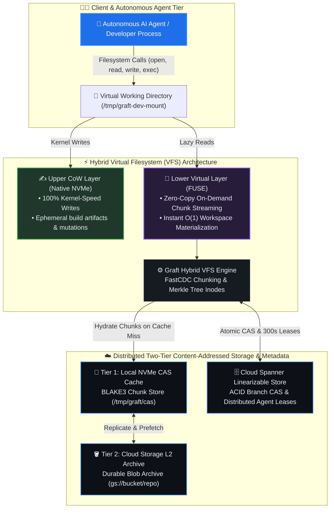

# Graft: Open-Source Virtualized Source Control for AI Agents & Monorepos

Graft is a high-performance, server-centric, virtualized source control system inspired by **Google Piper / CitC** and **Anthropic Scion**. It is purpose-built for the **Agentic Era**, where autonomous coding agents and automated CI test-and-repair loops generate code at 10x–100x human scale.

---

## The Problem Graft Solves

Traditional version control (Git) was designed around two fundamental assumptions:
1. **Decentralized & Offline-first**: Every developer clones the entire repository history onto their local machine.
2. **Human Velocity**: Developers make a handful of commits per day, and workspace creation can take seconds to minutes.

In the AI era, these assumptions cause catastrophic bottlenecks:
* **Massive Concurrency**: A team running 50 autonomous agent instances in parallel requires 50 isolated workspaces. Cloning and checking out a 20 GB repository 50 times consumes 1 TB of disk and saturates local NVMe and network bandwidth.
* **Wasteful Hydration**: An agent often touches only 2 to 5 files to complete a task. Git forces downloading and materializing 100,000+ files for every checkout.
* **Trunk Contention**: At high merge frequencies (>10,000 commits/day), branches become stale within minutes, forcing agents and CI to constantly rebase and re-verify.

---

## Architectural Highlights



Graft solves this by decoupling the **storage DAG** from the **working copy**:

1. **$O(1)$ Instant Workspaces**: Spawning a new, fully isolated workspace at any commit takes **$< 50\text{ ms}$**, regardless of repository size.
2. **CitC-Style Lazy Hydration**: Files are fetched from Content-Addressed Storage (CAS) only when opened or executed. Unopened files consume zero network bandwidth and zero local disk space.
3. **The Hybrid Filesystem (FUSE + OverlayFS)**:
   * **Lower Layer (Read-Only FUSE)**: Virtual directory tree streaming chunks from CAS on demand.
   * **Upper Layer (Native NVMe CoW)**: Native kernel Copy-on-Write directory. Compilers, linters, and agents write intermediate build artifacts at **100% native kernel speed** with zero FUSE context-switch overhead.
4. **Instant Diff & Commit**: Committing changes doesn't require scanning the entire working tree. Graft only inspects the local CoW upper layer, hashing only modified files in milliseconds ($O(\text{modified})$ time).
5. **Server-Side 3-Way Merkle Merging & AST Semantic Merge Engine**: Reconciles parallel agent branches or ports individual commit deltas directly in CAS or active workspaces in $O(\text{changed})$ time with $O(1)$ subtree pruning. Features a **lossless Concrete Syntax Tree (CST) semantic merge engine** (for Rust, Python, Go, and JS/TS) that automatically unions independent imports, cleanly resolves adjacent function additions, recurses 1 level into containers (`impl`, `mod`, `class`), and surgically scopes conflicts strictly to individual declarations.
6. **Distributed Two-Tier Storage**: Combines a local NVMe L1 cache with durable Google Cloud Storage (`gs://...`) L2 persistence.
7. **Cloud Spanner Linearizable Metadata**: Sub-millisecond KeySet CRUD operations (`/v1/{session}:read` and `/v1/{session}:commit`) with atomic Compare-And-Swap (CAS) branch coordination and workspace lease locking.

---

## Quickstart

### 1. Build & Verify
```bash
cargo build --release --features fuse
graft --version
```

### 2. Configure Storage (Local vs. Cloud)
Graft uses persistent configuration in `$HOME/.graft/config.json`:

```bash
# Option A: Local storage (default, zero setup needed)
graft config set cas_dir /tmp/graft/cas

# Option B: Distributed Cloud storage (GCS + Spanner)
graft config set remote gs://my-team-bucket/graft-repo
graft config set spanner_database projects/my-project/instances/my-instance/databases/graft-metadata
graft spanner init  # One-time schema initialization
```

### 3. Essential 30-Second Workflow
```bash
# 1. Ingest repository into Content-Addressed Storage (CAS)
graft ingest /path/to/my-repo

# 2. Spawn & mount an isolated, writable workspace in < 50ms (runs unprivileged FUSE)
graft workspace mount task-101 --branch main --target /tmp/task-101-mount -d

# 3. Agent edits files and runs tests inside /tmp/task-101-mount...
echo "pub fn multiply(a: i32, b: i32) -> i32 { a * b }" >> /tmp/task-101-mount/math.rs

# 4. Inspect touched files and unified diff in O(modified) time (< 1ms)
graft workspace status task-101
graft diff --workspace task-101

# 5. Commit touched files and advance branch atomically
graft commit -m "Implement multiplication" --workspace task-101

# 6. View commit log or browse code & search in Web UI
graft log main --limit 5
graft web --port 8080 -d

# 7. Unmount & clean up workspace
graft workspace unmount /tmp/task-101-mount
graft workspace destroy task-101
```

---

## Documentation Hub

Graft's comprehensive documentation is organized into two primary sections under [`docs/`](docs/README.md):

### 📖 User Manual & Operational Guides (`docs/manual/`)
* [**User Manual Overview**](docs/manual/README.md): Overview of user guides, quickstart, and workflows.
* [**Quickstart Tutorial**](docs/manual/quickstart.md): Step-by-step walkthrough from building to committing and exporting patches.
* [**CLI Reference Manual**](docs/manual/cli_reference.md): Complete reference guide for every command, option, flag, and environment variable.
* [**Advanced Workflows**](docs/manual/workflows.md): Operational recipes for multi-agent branching, GCS cloud fleets, Spanner ACID leases, and FUSE mounting.

### 🏛️ System Architecture Specifications (`docs/architecture/`)
* [**Architecture Specifications Overview**](docs/architecture/README.md): Master technical specifications index.
* [**System Overview & Lifecycle**](docs/architecture/overview.md): High-level system architecture, component topology, and agent sequence diagrams.
* [**Storage Model & CAS Data Structures**](docs/architecture/storage_model.md): BLAKE3-256 digests, FastCDC chunking, NVMe L1 cache + GCS L2 replication.
* [**Hybrid Virtual Filesystem (FUSE + OverlayFS)**](docs/architecture/vfs_hybrid.md): VFS in-memory tree, lazy directory expansion, and zero-copy `pread64` reads.
* [**Server-Side 3-Way Merkle Merge Engine**](docs/architecture/merge_engine.md): LCS diff3 hunk merging, $O(1)$ subtree pruning, and Spanner branch Compare-And-Swap.

---

## Directory Layout

```
graft/
├── Cargo.toml                  # Standalone Rust crate configuration
├── README.md                   # Project overview & documentation hub
├── docs/                       # Architectural whitepapers & user guides
│   ├── README.md               # Master documentation index
│   ├── architecture/           # Technical specifications & design docs
│   │   ├── README.md           # Architecture index
│   │   ├── overview.md         # System topology & lifecycle
│   │   ├── storage_model.md    # CAS, BLAKE3, FastCDC, GCS L2
│   │   ├── vfs_hybrid.md       # Hybrid FUSE + OverlayFS VFS
│   │   └── merge_engine.md     # 3-way Merkle merge engine & Spanner CAS
│   └── manual/                 # Operational manuals & CLI references
│       ├── README.md           # User manual index
│       ├── quickstart.md       # 5-minute hands-on tutorial
│       ├── cli_reference.md    # Complete CLI command reference
│       └── workflows.md        # Advanced multi-agent & cloud workflows
├── proto/                      # Protobuf schema for CAS Merkle trees & commits
│   ├── README.md               # Protobuf documentation
│   └── cas.proto               # Protobuf definition
├── src/                        # Core Rust implementation
│   ├── README.md               # Subsystem map
│   ├── lib.rs                  # Library entry point & re-exports
│   ├── main.rs                 # CLI entry point (workspace, commit, branch, merge, mount, web)
│   ├── cas.rs                  # Content-Addressed Storage module root
│   ├── cas/                    # BlobStore, GCS, CachedStore, commit tree mutation, merge
│   ├── git.rs                  # Git interoperability module root
│   ├── git/                    # Directory ingestion, unified diff, patch export
│   ├── metadata.rs             # Metadata store module root
│   ├── metadata/               # Local file store & Cloud Spanner CRUD / leases
│   ├── review.rs               # Pull request & code review models
│   ├── vfs.rs                  # Virtual Filesystem module root
│   ├── vfs/                    # In-memory VfsTree & FUSE server driver
│   ├── web.rs                  # Embedded Web server, router, & REST API
│   ├── web/                    # Code Search engine, templates, and handlers
│   ├── workspace.rs            # Workspace orchestration module root
│   └── workspace/              # OverlayFS manager & upperdir scanner
└── tests/                      # Integration and E2E test suites
    ├── README.md               # Test harness overview
    └── e2e/                    # End-to-end multi-agent test workflows
```

---

## Testing & Verification

Graft includes comprehensive unit tests and isolated end-to-end integration workflows:

```bash
# Run all unit tests, integration tests, and doc tests (100 tests)
cargo test

# Run tests against live Google Cloud Spanner instance (if configured)
GRAFT_TEST_LIVE_SPANNER=1 cargo test --test e2e spanner_workflow
```

---

## License

Licensed under either of [Apache License, Version 2.0](http://www.apache.org/licenses/LICENSE-2.0) or [MIT License](http://opensource.org/licenses/MIT) at your option.
