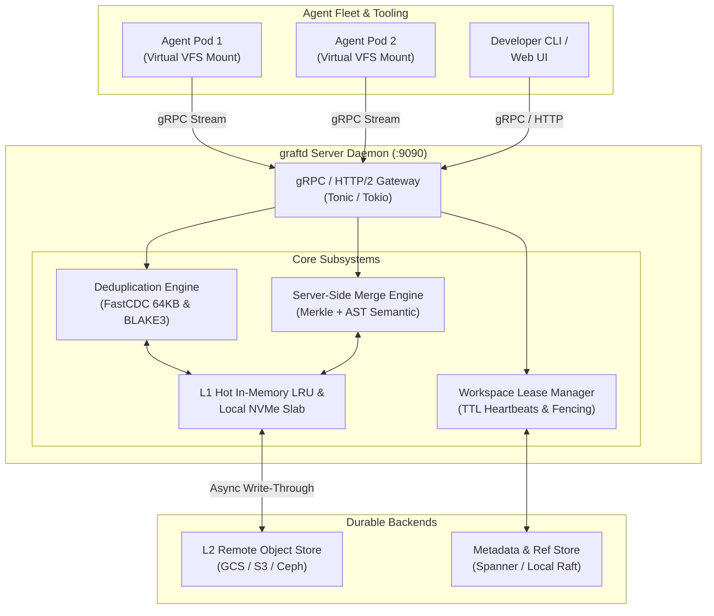
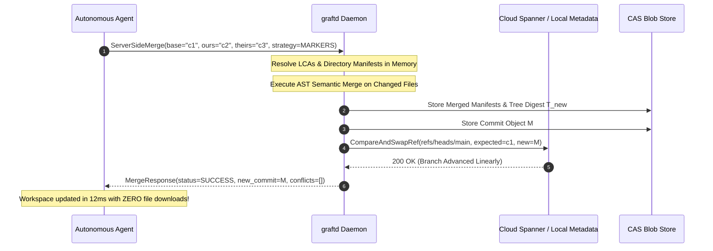

# Architecture Design Document: `graftd` Server-Centric Monorepo Daemon

**Author**: Graft Contributors  
**Status**: Proposed / Design Review  
**Target Release**: Graft v0.2.0  
**References**: `proto/cas.proto`, `docs/architecture/storage_model.md`, `docs/architecture/vfs_hybrid.md`

---

## 1. Executive Summary & Motivation

Traditional version control architectures (e.g. Git) are **client-heavy**: every developer and automated agent must download full repository histories, execute local 3-way merges on physical disk, and hold local copies of the object database.

In the **Agentic Era**, where dozens or hundreds of autonomous AI coding agents concurrently generate, test, and repair code:
1. **Network & Disk Exhaustion**: 50 parallel agents cloning or checking out 10 GB repositories waste 500 GB of network bandwidth and disk I/O, repeatedly transferring identical blobs.
2. **Credential Proliferation**: Direct cloud storage access requires provisioning GCP/AWS credentials into every ephemeral agent container.
3. **Client-Bound Merging**: Requiring agents to pull remote branches down to local disk just to resolve merges introduces latency and sync races.

**`graftd`** is the server-side monorepo daemon for Graft (inspired by the backend services powering **Google Piper** and **Anthropic Scion**). It decouples the storage and compute engine from the agent clients:
- **Centralized Content-Addressed Storage (CAS)**: Agents query and stream only the specific file chunks they touch.
- **Fleet-Wide Zero-Copy Deduplication**: If Agent 1 creates a 50 MB build artifact or source tree, Agent 2 on another machine accesses it in $< 10\text{ ms}$ without re-uploading or duplicating storage.
- **Server-Side Semantic Merging**: Agents request merges via RPC; `graftd` executes the Merkle tree walk and AST semantic merge entirely in memory on the server, advancing trunk via atomic Compare-And-Swap (CAS) in $< 20\text{ ms}$ with **zero file downloads**.

---

## 2. System Architecture & Topology

`graftd` is designed to run in two interchangeable topologies:
1. **Local Mode (Zero Infrastructure)**: Runs directly as a background process on the developer's laptop or Cloudtop (`localhost:9090`), providing shared CAS caching across local workspaces and terminal sessions.
2. **Distributed Cluster Mode**: Runs as a central service inside a Docker container or Kubernetes cluster, backed by NVMe SSD caching, Google Cloud Storage (GCS), and Google Cloud Spanner.



---

## 3. Core Subsystems

### 3.1 gRPC & HTTP/2 Streaming Gateway
Built with `tonic` and `tokio`, the gateway exposes high-throughput bidirectional streaming RPCs. It uses HTTP/2 multiplexing so a single TCP connection per agent handles concurrent file reads, chunk uploads, and ref queries without connection thrashing.

### 3.2 Two-Tier Storage Router
- **Tier 1 (Local NVMe / RAM Cache)**: Zero-copy `pread64` and memory-mapped slab files for hot blobs and directory manifests.
- **Tier 2 (Durable Cloud Storage)**: Asynchronous, write-coalesced write-through to Google Cloud Storage (`gs://...`) using `ifGenerationMatch=0` idempotency.

### 3.3 Server-Side Execution Engine
Instead of shipping files to agents for compilation of merge results:
- **Merkle Diff & 3-Way Merge**: `graftd` walks the Merkle DAG directly in memory ($O(\text{changed})$).
- **AST Semantic Reconciliation**: Runs `semantic_merge` across Rust, Python, Go, and JS/TS files in-process.
- **Commit Synthesis**: Immediately hashes the resulting Merkle directory manifests, creates the new `Commit` object, and updates the branch ref via Spanner CAS.

### 3.4 Distributed Workspace Lease Coordinator
- Agents acquire leases on workspace names (`agent-task-42`).
- Leases carry an epoch fencing token and a 60-second TTL renewed via background heartbeats.
- Prevents split-brain races where two agents accidentally operate on the same logical workspace.

---

## 4. Protocol & RPC Service Definitions

The communication contract extends `proto/cas.proto`:

```protobuf
syntax = "proto3";
package graft.cas.v1;

// -----------------------------------------------------------------------------
// Content-Addressed Storage Service
// -----------------------------------------------------------------------------
service CasService {
  // Query which digests are missing from the server before uploading.
  // Prevents sending duplicate chunks over the wire.
  rpc FindMissingBlobs(FindMissingBlobsRequest) returns (FindMissingBlobsResponse);

  // High-throughput streaming upload of missing chunks.
  rpc BatchWrite(stream BatchWriteRequest) returns (BatchWriteResponse);

  // Streams chunks or file payloads to the client for lazy hydration.
  rpc BatchRead(BatchReadRequest) returns (stream BatchReadResponse);

  // Streams a single large blob (> 2 MB) chunk-by-chunk.
  rpc StreamBlob(StreamBlobRequest) returns (stream BlobChunk);
}

// -----------------------------------------------------------------------------
// Branch & Reference Coordination Service
// -----------------------------------------------------------------------------
service RefService {
  // Retrieves the current commit digest for a branch or tag.
  rpc GetRef(GetRefRequest) returns (GetRefResponse);

  // Atomic Compare-And-Swap (CAS) advancement of a branch pointer.
  rpc CompareAndSwapRef(CompareAndSwapRefRequest) returns (CompareAndSwapRefResponse);

  // Lists all branches and tags with their commit metadata.
  rpc ListRefs(ListRefsRequest) returns (ListRefsResponse);
}

// -----------------------------------------------------------------------------
// Server-Side Merge & Workspace Orchestration Service
// -----------------------------------------------------------------------------
service MergeService {
  // Executes a 3-way Merkle + AST semantic merge entirely on the server.
  // Returns the resulting commit digest and conflict statuses without file transfers.
  rpc ServerSideMerge(ServerSideMergeRequest) returns (ServerSideMergeResponse);

  // Server-side cherry pick of a commit delta onto a target branch.
  rpc ServerSideCherryPick(ServerSideCherryPickRequest) returns (ServerSideCherryPickResponse);
}

// -----------------------------------------------------------------------------
// Workspace Lease Service
// -----------------------------------------------------------------------------
service WorkspaceService {
  rpc AcquireLease(AcquireLeaseRequest) returns (AcquireLeaseResponse);
  rpc HeartbeatLease(HeartbeatLeaseRequest) returns (HeartbeatLeaseResponse);
  rpc ReleaseLease(ReleaseLeaseRequest) returns (ReleaseLeaseResponse);
}
```

---

## 5. Detailed End-to-End Workflows

### 5.1 Zero-Download Server-Side Merge



### 5.2 Optimistic Chunked Upload (Agent $\to$ Server)
1. Agent hashes local file modifications using FastCDC (target chunk size 64KB) and BLAKE3.
2. Agent calls `FindMissingBlobs([hash1, hash2, ...])`.
3. `graftd` checks its in-memory hash set; returns `[hash2]` (hash1 already exists in cluster).
4. Agent uploads only `hash2` via HTTP/2 streaming.
5. Storage bandwidth is reduced by 90–99% across the fleet.

---

## 6. Resource Footprint & Performance Targets

| Metric | Target | Verification Method |
| :--- | :--- | :--- |
| **Idle Memory Footprint** | $< 35\text{ MB}$ RSS | Local profiling via `valgrind` / `jemalloc` |
| **P99 Read Latency (Cached)** | $< 1.5\text{ ms}$ | `ghz` gRPC benchmarking on 64KB chunks |
| **P99 Server-Side Merge Latency** | $< 25\text{ ms}$ | 3-way merge on 10,000-file Merkle tree with 20 changed files |
| **Concurrent Stream Limit** | $\ge 1,000$ active streams | Tokio epoll event loop with bounded buffer channels |
| **Deduplication Efficiency** | $\ge 85\%$ cross-agent saving | Simulated 10-agent concurrent refactoring suite |

---

## 7. Security & Isolation Model

1. **mTLS & Token Authentication**:
   - Internal cluster deployments use mutual TLS (mTLS).
   - Agent pods authenticate via short-lived bearer tokens or service accounts.
2. **Path Traversal Protection**:
   - Content addressing eliminates path injection vulnerabilities: blobs are strictly addressed by 32-byte BLAKE3 digests.
3. **Fencing Tokens**:
   - Every workspace lease increments an integer epoch. Any write containing a stale fencing token is rejected with `ABORTED`.

---

## 8. Phased Implementation Roadmap

- [ ] **Phase 1: Minimal CAS Daemon**:
  - Implement `CasService` with `FindMissingBlobs`, `BatchRead`, and `BatchWrite` in `src/daemon/cas_service.rs` using `tonic`.
  - Add CLI command: `graft daemon --port 9090 --storage-dir /tmp/graft`.
- [ ] **Phase 2: Remote BlobStore Client**:
  - Implement `RemoteBlobStore` implementing `crate::cas::BlobStore` that speaks gRPC to `graftd`.
  - Seamlessly drop into local VFS and workspace mounts via `--server http://127.0.0.1:9090`.
- [ ] **Phase 3: Server-Side Merge & Leases**:
  - Expose `MergeService` and `WorkspaceService`.
  - Wire up server-side AST semantic merge execution.
- [ ] **Phase 4: Embedded Auto-Daemon**:
  - If `--server` is not specified, CLI automatically uses in-process local storage without requiring manual daemon management.
