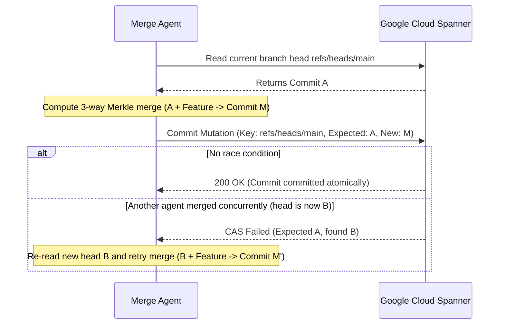

# Architecture Specification: Server-Side 3-Way Merkle Merge Engine

This document specifies Graft's server-side 3-way Merkle merge algorithm, line-level diff3 hunk reconciliation, conflict marker generation, and linearizable branch advancement via Google Cloud Spanner.

---

## 1. The Scaling Problem in Multi-Agent Merging

Traditional Git branching creates a massive serialization bottleneck when scaled to dozens or hundreds of AI coding agents:
1. **Worktree Bound**: Merging requires cloning or checking out worktrees on disk, reading full files into memory, and executing local three-way merges.
2. **Lost Updates & Stale Heads**: Agents racing to merge into `main` overwrite each other's branch pointers without atomic Compare-And-Swap.
3. **Expensive Rebasing**: When trunk moves fast, agents spend more compute rebasing and re-running test suites than writing code.

---

## 2. Server-Side Merkle Merging ($O(\text{changed})$ Time)

Graft performs 3-way merges directly in Content-Addressed Storage without requiring a working copy on disk:

```
        Commit Base (Ancestor)
              /        \
             /          \
   Commit Ours         Commit Theirs
            \            /
             \          /
         Merged Commit (2 Parents)
```

### Algorithm Pipeline
1. **Lowest Common Ancestor (LCA)**:
   Traverses commit ancestry graphs via Breadth-First Search (BFS) to identify the closest common ancestor commit $B$.
2. **Fast-Forward Check**:
   - If $B = T$, Ours is already up-to-date (no-op).
   - If $B = O$, Theirs is a direct descendant; Graft performs a fast-forward merge by pointing the branch to $T$ in $O(1)$ time.
3. **Subtree Pruning ($O(1)$ Digest Comparison)**:
   When recursing through directory manifests:
   $$\text{If } D_{\text{ours}} = D_{\text{base}}, \text{ emit } D_{\text{theirs}} \quad (\text{Ours did not touch subtree})$$
   $$\text{If } D_{\text{theirs}} = D_{\text{base}}, \text{ emit } D_{\text{ours}} \quad (\text{Theirs did not touch subtree})$$
   $$\text{If } D_{\text{ours}} = D_{\text{theirs}}, \text{ emit } D_{\text{ours}} \quad (\text{Both made identical changes})$$
   Unchanged directories containing thousands of files are resolved instantly by copying a 32-byte digest pointer, **completely bypassing subdirectory traversal**.

---

## 3. LCS Diff3 Line-Level Hunk Merging

When both branches modify the same file ($D_{\text{ours}} \neq D_{\text{theirs}}$ and neither equals $D_{\text{base}}$), Graft applies an LCS (Longest Common Subsequence) diff3 hunk reconciliation engine:

1. **Tokenization**: Files are parsed into line slices.
2. **LCS Match Points**: A two-dimensional dynamic programming table computes common anchor lines between Base and Ours, and between Base and Theirs.
3. **Non-Overlapping Edits**:
   - Changes made in disjoint sections of the file (e.g. Agent 1 adds imports at line 5, Agent 2 adds a helper function at line 120) merge cleanly with zero manual intervention.
   - Sibling code syntax (like closing braces `}`) is matched against base anchors rather than collapsed, preserving valid code syntax.
4. **Conflicting Overlapping Edits**:
   - When both sides edit identical line spans with differing contents, Graft inserts standard git-compatible conflict markers:
     ```text
     <<<<<<< ours
     let timeout = Duration::from_secs(30);
     =======
     let timeout = Duration::from_secs(60);
     >>>>>>> theirs
     ```
   - By default, `graft merge` aborts on conflict to prevent corrupting trunk. With `--allow-conflicts`, conflict markers are committed to CAS so agents or human engineers can resolve them in a follow-up commit.

---

## 4. AST & Semantic 3-Way Merge Engine for Autonomous AI Agents

When multiple autonomous coding agents work concurrently on a repository, standard line-level merge often fails due to adjacent insertions (e.g. adding two functions to the bottom of the same file or adding two independent imports to the top).

Graft implements a **lossless, Concrete Syntax Tree (CST) semantic merge engine** (`src/cas/semantic_merge.rs`) supporting Rust, Python, Go, and JavaScript/TypeScript:

```
            Base File (main.rs)
               ┌─────────┐
               │ fn a()  │
               └────┬────┘
          ┌─────────┴─────────┐
          ▼                   ▼
     Agent 1 (Ours)      Agent 2 (Theirs)
    ┌──────────────┐    ┌──────────────┐
    │ fn a()       │    │ fn a() [edit]│
    │ fn b() [new] │    │              │
    └───────┬──────┘    └──────┬───────┘
            └─────────┬────────┘
                      ▼
           AST Semantic Merge
          ┌───────────────────┐
          │ fn a() [edited]   │  ✅ Auto-Merged!
          │ fn b() [new]      │  ✅ Zero Conflict!
          └───────────────────┘
```

### Key Capabilities
1. **3-Way Import Union & Deletion**:
   - `kept_base = base ∩ ours ∩ theirs`
   - `additions = (ours \ base) ∪ (theirs \ base)`
   - Single-sided deletions from base are respected rather than resurrected.
2. **Lossless CST Byte Preservation**:
   - Trivia-preserving parser partitions files into byte-contiguous spans such that concatenating elements reproduces the original file byte-for-byte (`reconstruct(parse(src)) == src`).
   - Handles complex language tokens including Rust lifetimes (`'a`, `'static`), raw string literals (`r#"..."#`), and Python indentation blocks.
3. **Container Recursing (1 Level Deep)**:
   - Recurses 1 level inside containers (`impl Foo`, `mod tests`, `class Service`), allowing concurrent method or `#[test]` additions from parallel agents to merge with **zero conflicts**.
4. **Surgical Intra-Item Conflict Scoping**:
   - When both agents modify the exact same function, line-level 3-way diff is scoped strictly inside that function, keeping the rest of the file 100% syntactically valid.
5. **Safe Fallback**:
   - Files > 1 MB, duplicate identifier keys in the same scope, or syntax failures fall back immediately to line-level diff3.

---

## 5. Linearizable ACID Branch Updates via Cloud Spanner

To guarantee that branch heads never experience lost updates or race conditions, Graft coordinates branches through **Google Cloud Spanner**:

### Atomic Compare-And-Swap (CAS) Loop


- **Pure Key-Value Operations**: Graft uses Spanner's `/v1/{session}:read` and `/v1/{session}:commit` mutations, avoiding SQL engine overhead for sub-millisecond updates.
- **Retry Semantics**: If a CAS conflict occurs, Graft automatically refreshes the base commit, recomputes the 3-way merge against the new trunk head, and retries up to 3 times before returning an error.
