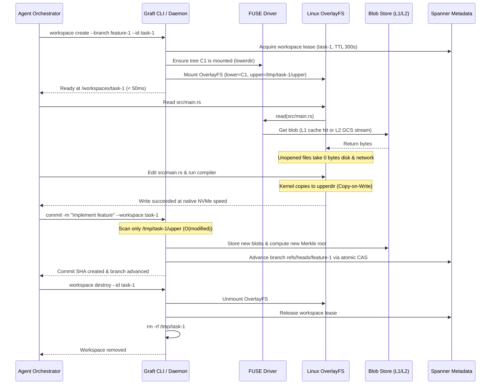

# Graft Architecture Specification: System Overview

## 1. System Overview

Graft is a distributed, content-addressed source control and virtual workspace system designed for high-concurrency automated agent workflows and large monorepos.

```
                          ┌──────────────────────────┐
                          │   Upstream Git Remote    │
                          │   (GitHub / GitLab / etc)│
                          └─────────────┬────────────┘
                                        │ (Sync commits)
                                        ▼
                          ┌──────────────────────────┐
                          │       Graft Server       │
                          │  - Object CAS Store      │
                          │  - Tree & Commit Index   │
                          │  - Server-Side Merge/Diff│
                          └─────────────┬────────────┘
                                        │ gRPC Streaming / GCS
                                        ▼
                          ┌──────────────────────────┐
                          │    Local Graft Daemon    │
                          │  - In-Memory VfsTree     │
                          │  - NVMe Chunk Cache (L1) │
                          └─────────────┬────────────┘
                                        │
                 ┌──────────────────────┴──────────────────────┐
                 ▼                                             ▼
  ┌─────────────────────────────┐               ┌─────────────────────────────┐
  │   FUSE Mount (lowerdir)     │               │   FUSE Mount (lowerdir)     │
  │   /var/run/graft/trees/sha1 │               │   /var/run/graft/trees/sha2 │
  └──────────────┬──────────────┘               └──────────────┬──────────────┘
                 │                                             │
                 ▼ (OverlayFS)                                 ▼ (OverlayFS)
  ┌─────────────────────────────┐               ┌─────────────────────────────┐
  │ Agent Workspace #1 (Merged) │               │ Agent Workspace #2 (Merged) │
  │ Upper: /tmp/agent-1/upper   │               │ Upper: /tmp/agent-2/upper   │
  │ Work:  /tmp/agent-1/work    │               │ Work:  /tmp/agent-2/work    │
  └─────────────────────────────┘               └─────────────────────────────┘
```

---

## 2. Core Subsystems

Graft is partitioned into four decoupled subsystems:

1. **Content-Addressed Storage (`src/cas/`)**:
   - Cryptographic immutability via **BLAKE3-256**.
   - Two-tier storage hierarchy: Local NVMe SSD (L1) + Google Cloud Storage (L2).
   - Fast Content-Defined Chunking (**FastCDC**) for deduplicated large assets.
   - Deterministic Merkle directory manifests with preserved file sizes and POSIX execution bits.

2. **Virtual Filesystem Engine (`src/vfs/`)**:
   - In-memory virtual inode hierarchy (`VfsTree`) with $O(1)$ Inode lookups and $O(\log K)$ child resolution via `BTreeMap`.
   - Lazy per-directory manifest expansion (`ensure_dir_loaded`) ensuring $O(1)$ instant mounts regardless of monorepo size.
   - User-space FUSE driver (`GraftFilesystem`) using zero-copy `pread64` on locally cached files to eliminate $O(N^2)$ chunk amplification.
   - Signal-safe daemon orchestration (`spawn_mount_fuse`) and graceful unmounting.

3. **Workspace Orchestration (`src/workspace/`)**:
   - Ephemeral Copy-on-Write (CoW) workspaces combining FUSE `lowerdir` with native NVMe `upperdir` via Linux OverlayFS.
   - Sub-second workspace creation ($< 50\text{ ms}$).
   - $O(\text{modified})$ upperdir delta scanning and instant commit creation.

4. **Distributed Metadata & Concurrency (`src/metadata/`)**:
   - Linearizable atomic Compare-And-Swap (CAS) on branch references.
   - Direct Google Cloud Spanner KeySet CRUD integration (`/v1/{session}:read` and `/v1/{session}:commit`), bypassing SQL compilation.
   - Distributed workspace lease locking with TTL heartbeats to prevent agent contention.

---

## 3. Agent Lifecycle Sequence



---

## 4. Architectural Deep-Dives

For detailed subsystem designs, refer to:
- [Storage Model & CAS Data Structures](storage_model.md)
- [Hybrid Virtual Filesystem (FUSE + OverlayFS)](vfs_hybrid.md)
- [Server-Side 3-Way Merkle Merge Engine](merge_engine.md)
