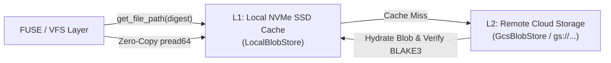

# Architecture Specification: Content-Addressed Storage (CAS) Model

This document specifies the Content-Addressed Storage subsystem of Graft: hashing algorithms, serialization formats, two-tier caching, and remote cloud replication.

---

## 1. Cryptographic Digest: BLAKE3-256

Every piece of data stored in Graft—individual file blobs, directory manifests, commit snapshots, and chunk indices—is identified by a 32-byte cryptographic digest pairing the hash with the uncompressed payload size:

$$\text{Digest} = \langle \text{blake3\_256}(\text{data}), \text{size\_bytes} \rangle$$

Formatted string representation:
```
<64-hex-characters>:<size_bytes>
# Example:
c54b58c223d8a52b821422ab8e08d666d39626c71c19b266946059dcfca3082f:1842
```

### Why BLAKE3 Instead of SHA-1 or SHA-256?
1. **Parallel Tree Hashing**: BLAKE3 is structured as a tree hash internally, allowing multi-threaded SIMD hashing exceeding **6 GB/s per core** (compared to ~400 MB/s for SHA-256). Ingesting 200,000 files in a monorepo does not saturate CPU.
2. **Sub-File Range Verification**: BLAKE3 permits cryptographically verifying chunks of a large file without hashing the preceding bytes.
3. **Payload Length Validation**: Retaining `size_bytes` directly in the Digest allows the FUSE layer and OS kernel to report file sizes via `stat` without downloading file content over the network.

---

## 2. Directory Manifest Serialization

A Directory in Graft is serialized deterministically as a canonical plain-text manifest sorted alphabetically by entry name.

### Grammar
```
Manifest   := Entry*
Entry      := FileEntry | DirEntry
FileEntry  := "FILE " Mode " " Name " " Digest "\n"
DirEntry   := "DIR " Name " " Digest "\n"
Mode       := "0755" | "0644"
Name       := [^\n\t /]+
Digest     := HexDigest ":" SizeBytes
```

### Example Manifest Payload
```text
CHUNKED 0644 weights.safetensors 9a112f48...:240 104857600
FILE 0644 Cargo.toml 8fa7210e782b5421cde...:820
FILE 0644 README.md c54b58c223d8a52b821...:1842
FILE 0755 build.sh f0412a884c718b42911...:256
DIR scripts e4019284218a09cf129...:180
DIR src 384307e412eee4b31a8...:420
```

Deterministic guarantees:
- Entries are ordered alphabetically using Rust's `BTreeMap<String, ManifestEntry>`.
- `CHUNKED` entries record `total_size` directly in the manifest, enabling `stat` and `ls -l` in the VFS with zero CAS blob fetches.
- Identical subtrees yield identical BLAKE3 digests, allowing instantaneous $O(1)$ deduplication and tree comparison.

---

## 3. Fast Content-Defined Chunking (FastCDC)

For large binaries, model weights, or massive database dumps exceeding 4 MB, Graft slices files into variable-length chunks using **FastCDC v2020** (`src/cas/chunker.rs`):
- **Target parameters**:
  - Threshold: $4\text{ MB}$ (files $\le 4\text{ MB}$ stay single `FILE` blobs)
  - Minimum chunk size: $256\text{ KB}$
  - Normal/Average chunk size: $1\text{ MB}$
  - Maximum chunk size: $4\text{ MB}$
- **Chunk Manifest Format (`CHUNKMANIFEST v1`)**:
  ```text
  CHUNKMANIFEST v1 <total_size_bytes> <whole_file_blake3_hex>
  CHUNK <offset> <length> <chunk_digest>
  CHUNK <offset> <length> <chunk_digest>
  ```
- **Deduplication**: When an agent edits a few bytes in a 500 MB file, only the affected $1\text{ MB}$ chunk is hashed and written to CAS. The remaining ~499 chunks retain their original digests, achieving $> 98\%$ storage savings.
- **Sub-Range / Sparse Streaming**: `GraftFilesystem::read` binary searches the chunk manifest via $O(\log C)$ `partition_point` to hydrate only the overlapping chunk(s) instead of downloading the entire file.

---

## 4. Two-Tier Storage Architecture: NVMe L1 + GCS L2

Graft implements a two-tier storage hierarchy (`CachedBlobStore`):



### 1. L1 Local NVMe Cache (`LocalBlobStore`)
- Located at `<cas_dir>` (defaults to `/tmp/graft/cas`).
- Sharded into 256 two-character directories (`00` to `ff`) using the first byte of the digest to ensure directory lookups remain fast on ext4/xfs:
  ```
  /tmp/graft/cas/
  ├── 38/
  │   └── 384307e412eee4b31a8...   <- Manifest
  ├── c5/
  │   └── c54b58c223d8a52b821...   <- README.md
  └── ea/
      └── eaf92b01b36f056f441...   <- Binary blob
  ```
- **Concurrency Safety**: Atomic rename (`tempfile` $\to$ target path) guarantees that reader processes never observe half-written files.

### 2. L2 Remote Cloud Store (`GcsBlobStore`)
- Backed by Google Cloud Storage (`gs://<bucket>/<prefix>`).
- Pure synchronous HTTP/1.1 transport (`ureq` + `rustls`) with zero heavy async runtime dependencies.
- **Idempotent Writes**: Writes specify `ifGenerationMatch=0`. If another agent uploaded the exact same blob concurrently, GCS returns HTTP 412 (Precondition Failed), which Graft treats as a successful cache hit.
- **Authentication**: Automatically falls back through:
  1. `GRAFT_GCS_TOKEN` / `GOOGLE_OAUTH_ACCESS_TOKEN` environment variables
  2. `gcloud auth print-access-token` (cached in memory for 45 minutes)
  3. Cloudtop / Google Compute Engine instance metadata server

---

## 5. Mark-and-Sweep Garbage Collection

As AI agents branch, test speculative code, and abandon dead-end patches, unreferenced Merkle manifests and chunk blobs accumulate in CAS. Graft implements a fail-closed, typed mark-and-sweep garbage collector (`src/cas/gc.rs`):

### 1. Root Discovery
Roots are aggregated across four authoritative layers:
- **`MetadataStore::list_refs`**: All branch heads (`refs/heads/*`), tags, and legacy bare refs.
- **`MetadataStore::list_leases`**: Distributed task leases stored in Cloud Spanner (`graft_workspace_leases`), protecting active uncommitted workspaces running on remote VMs.
- **`WorkspaceManager::list_workspaces`**: Active local workspaces and their tracked branches.
- **Explicit CLI `--keep-root`**: User-pinned commits or trees.

### 2. Typed Merkle DAG Traversal
Graft traverses container objects (`Commit`, `DirectoryManifest`, `ChunkManifest`) while **never reading leaf file or chunk blobs**:
- When encountering `ManifestEntry::File { digest, .. }`, the BLAKE3 hash is marked directly into the live set. Zero data payload bytes are loaded or transferred.
- When encountering `ChunkManifest`, all child chunk digests are marked directly.
- **Fail-Closed**: If any root or intermediate manifest fails to deserialize, GC aborts immediately before any deletion.
- **Empty Root Guard**: If zero roots are found while CAS contains data, GC aborts to prevent catastrophic data wipes.

### 3. Grace Period Safety Window
Unreferenced blobs with modification times within the grace window (default: 24 hours) are preserved (`skipped_recent_blobs`). This prevents race conditions with concurrent agents creating uncommitted blobs. Re-referenced blobs have their `mtime` refreshed upon deduplicated writes in `LocalBlobStore::put`.
