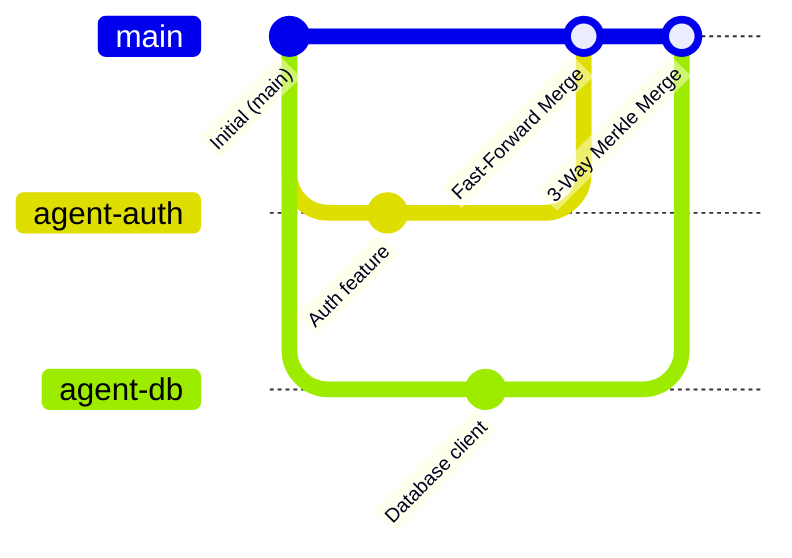

# Advanced Graft Workflows & Operations

This document provides step-by-step guides for advanced deployment and multi-agent development scenarios.

---

## Workflow 1: High-Concurrency Multi-Agent Branching & 3-Way Merging

When multiple autonomous agents work in parallel on the same codebase, traditional Git branching causes trunk contention and rebasing thrash. Graft allows agents to branch, commit, and 3-way merge in $O(\text{changed})$ time without disk checkouts:



### Execution Steps
```bash
# 1. Create parallel branches from main
graft branch agent-auth --from main
graft branch agent-db --from main

# 2. Agent 1 creates workspace, mounts it as writeable CoW, edits auth code, and commits
graft workspace create ws-auth --branch agent-auth
graft workspace mount ws-auth --daemon
# (Agent 1 edits files in /tmp/graft/storage/ws-auth/merged)
graft workspace status ws-auth
graft commit -m "Implement token authentication" --workspace ws-auth
graft workspace unmount ws-auth

# 3. Agent 2 concurrently creates workspace, mounts it, edits database code, and commits
graft workspace create ws-db --branch agent-db
graft workspace mount ws-db --daemon
# (Agent 2 edits files in /tmp/graft/storage/ws-db/merged)
graft workspace status ws-db
graft commit -m "Implement Spanner database client" --workspace ws-db
graft workspace unmount ws-db

# 4. Merge Agent 1 into main (automatic fast-forward merge)
graft merge agent-auth --into main

# 5. Merge Agent 2 into main (automatic 3-way Merkle merge)
# Unchanged subtrees are resolved in O(1); non-overlapping file edits are merged cleanly
graft merge agent-db --into main

# 6. Verify merged commit graph
graft log main --limit 3
```

---

## Workflow 2: Distributed Cloud Storage (`gs://`) Across Multi-VM Agent Fleets

For fleets of agent containers running in Google Kubernetes Engine (GKE) or Cloudtop:

```bash
# Set configuration once via graft config (or via GRAFT_REMOTE / GRAFT_CAS_DIR):
graft config set remote gs://my-team-bucket/graft-repo
graft config set cas_dir /mnt/nvme/cas

# 1. Seed or ingest repository on workstation (automatically uploads to GCS with write-through caching)
graft ingest /repo

# 2. Worker VM with cold local cache starts a task instantly
# Zero files are downloaded upfront!
graft workspace create task-worker-42 --branch main

# 3. Worker reads only the 2 files needed for its task
# Lazy hydration fetches those 2 files from GCS, caches on local NVMe, and serves to the agent

# 4. Worker commits and pushes new blobs directly back to GCS
graft commit --workspace task-worker-42 -m "Automated bugfix for issue #42"
```

---

## Workflow 3: Linearizable ACID Coordination with Google Cloud Spanner

In distributed environments, multiple agent orchestrators require strict serializability to prevent split-brain branch updates and double-assigned tasks:

```bash
# Configure once:
graft config set spanner_database projects/vmm-net-prod/instances/graft-instance/databases/graft-metadata
graft config set remote gs://my-team-bucket/graft-repo

# Initialize Spanner schema:
graft spanner init

# 1. Atomically acquire exclusive lease on a task workspace (sub-millisecond KeySet CRUD)
graft lease acquire task-billing-sync --ttl-secs 300

# 2. Periodic background heartbeat during agent execution
graft lease heartbeat task-billing-sync --ttl-secs 300

# 3. Atomic branch updates
# Graft utilizes Spanner's Compare-And-Swap (CAS) to verify that 'main' has not advanced
# before updating its head. If another agent merged first, Graft retries automatically.
graft merge feature-billing --into main

# 4. Release task lease upon completion
graft lease release task-billing-sync
```

---

## Workflow 4: Interactive FUSE Virtual Filesystem (`graft mount`)

Inspect historical commits, review branches, or provide read-only virtual repositories to security scanners without disk consumption:

```bash
# 1. Mount any branch or commit in the background
mkdir -p /mnt/repo-inspect
graft mount /mnt/repo-inspect --commit feature-auth -d

# 2. Run standard Linux tools against the virtual filesystem
ls -la /mnt/repo-inspect/src
find /mnt/repo-inspect -name "*.rs"
stat /mnt/repo-inspect/scripts/build.sh # Preserves 0755 execute bits

# 3. Stream only what is read
# 'head -n 10 /mnt/repo-inspect/huge_file.txt' downloads only the first chunk!

# 4. Graceful unmount
graft unmount /mnt/repo-inspect
```

---

## Workflow 5: FastCDC Large-File Content-Defined Chunking

For repositories containing large binary assets, model weights (`.safetensors`, `.onnx`), or test datasets:

1. **Automatic Ingestion & Slicing**: Files $> 4\text{ MB}$ are sliced via FastCDC v2020 (min 256 KB, avg 1 MB, max 4 MB) and indexed via a canonical plain-text `ChunkManifest`.
2. **Shift-Resistant Deduplication**: Inserting or editing bytes in a 500 MB model weight file only writes the affected 1 MB chunk. Untouched chunks retain identical BLAKE3 hashes.
3. **Sub-Range Streaming**: Running `head -n 20` or inspecting headers on a mounted 10 GB file only reads chunk 0 without downloading the rest.
4. **Seamless 3-Way Merge & Export**: Merging branches that touch chunked files tracks conflict states cleanly, while `graft export` streams variable-length chunks sequentially into disk files with zero RAM amplification.

---

## Workflow 6: Automated Storage Reclamation via Garbage Collection (`graft gc`)

Maintain healthy NVMe and cloud storage quota across high-turnover agent test runs:

```bash
# 1. Preview reclaimable storage across abandoned branches and deleted files (dry run)
graft gc --dry-run

# 2. Run safe garbage collection with a 24-hour grace period
# Protects recently written uncommitted blobs and active distributed leases
graft gc --grace-period-hours 24

# 3. Pin specific experimental commits from being swept
graft gc --keep-root e4019284218a09cf...

# 4. Aggressive cleanup on dedicated scratch nodes (0-second grace window)
graft gc --grace-period-secs 0
```

---

## Workflow 7: Cherry-Picking & Interactive Conflict Resolution Assistant (`graft cherry-pick`)

Port individual bugfixes or feature commits across divergent agent branches directly in CAS or within active workspaces:

```bash
# 1. Clean cherry-pick of a bugfix commit onto an active workspace
graft cherry-pick c41a87e2... --workspace agent-worker-1

# 2. Stage changes without recording a commit for inspection or local testing
graft cherry-pick c41a87e2... --workspace agent-worker-1 --no-commit

# 3. Direct server-side CAS branch cherry-pick (zero disk checkouts required)
graft cherry-pick c41a87e2... --branch staging

# 4. Interactive conflict resolution lifecycle
# When a cherry-pick encounters overlapping line conflicts, Graft writes 3-way markers:
# <<<<<<< ours
# line on current branch
# =======
# line from cherry-picked commit
# >>>>>>> theirs
graft cherry-pick f902b11a... --workspace agent-worker-1

# Graft prevents accidental commits while conflict markers remain:
# graft cherry-pick --continue -> fails closed with remaining file list

# After editing conflict markers in the workspace, finalize the cherry-pick:
graft cherry-pick --continue --workspace agent-worker-1

# Or abort and restore the workspace to its exact pre-cherry-pick state:
graft cherry-pick --abort --workspace agent-worker-1

# 5. Programmatic conflict strategy overrides for autonomous agents
graft cherry-pick c41a87e2... --workspace agent-worker-1 --strategy ours
graft cherry-pick c41a87e2... --workspace agent-worker-1 --strategy theirs
```
